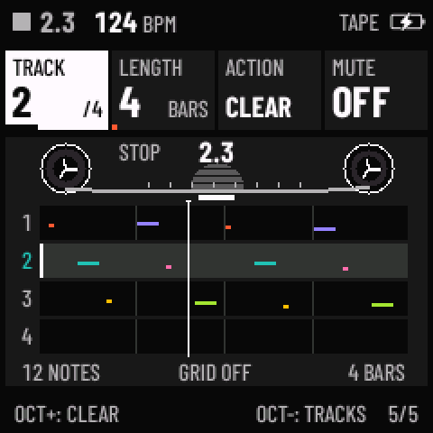
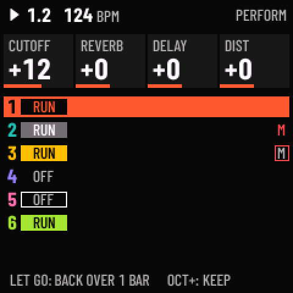
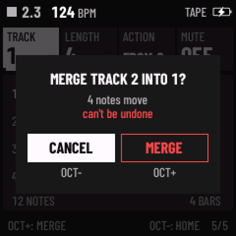
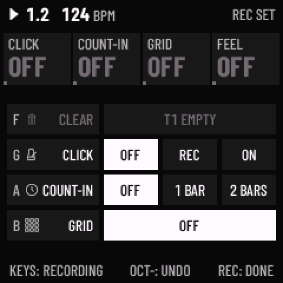
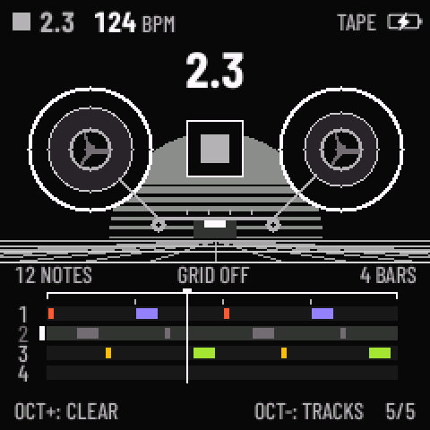

<p align="center">
  <picture>
    <source media="(prefers-color-scheme: dark)" srcset="docs/logo/skiff-logo.svg">
    
  </picture>
</p>

<p align="center"><b>A six-track groovebox firmware for the M-VAVE SMK-37 Pro</b><br>
synths and drums, a note tape, live performance, and a screen that shows what every control does</p>

<p align="center">
  <a href="https://github.com/illuminus5/skiff/releases/latest"></a>
  <a href="LICENSE"></a>
  
</p>

**This fork targets the M-VAVE SMK-37 only.** It diverges from upstream [illuminus5/skiff](https://github.com/illuminus5/skiff),
which supports the FM-1 too: the FM-1 build, its package and its tests are gone from here, so `./build.sh` makes the
SMK-37 package. Where the text below says "the FM-1" it is upstream's wording for the unit, kept as it was (the history
of each release, the shared behaviour); [SMK37.md](SMK37.md) says what the keyboard does.

<p align="center"><b>New in 2.6:</b> the Skiff Editor's Screen tab: the FM-1's screen, large, on a computer or an
Android tablet, following the unit as you play ·
<a href="https://github.com/illuminus5/skiff/releases/tag/v2.6">the release notes</a><br>
<b>New in 2.5.1:</b> FX › DRIVE's CRUSH no longer cracks on chords and loud notes, as LOFI PIANO
did ·
<a href="https://github.com/illuminus5/skiff/releases/tag/v2.5.1">the release notes</a><br>
<b>New in 2.5:</b> 16 voices a track, a true-stereo delay and chorus, takes played while stopped
(Skiff finds the tempo), the delay and reverb beside their sends, a song you can follow and start from any entry, a
FILTER insert, STRUM, and fixes from your issues ·
<a href="https://github.com/illuminus5/skiff/releases/tag/v2.5">the release notes</a><br>
<b>New in 2.2:</b> USB MIDI: everything the tracks play goes out, timed with the sound (steps, the
arp, chords, ratchets), MIDI clock and Start / Stop, a track as an external synth's, knob CCs, remote buttons, Song
Position; newer FM-1s with another flash chip save and update ·
<a href="https://github.com/illuminus5/skiff/releases/tag/v2.2">the release notes</a><br>
<b>New in 2.1.1:</b> a drum struck again while it still rings starts without a click: tom rolls,
ratchets and the long-decay kits ·
<a href="https://github.com/illuminus5/skiff/releases/tag/v2.1.1">the release notes</a><br>
<b>New in 2.1:</b> chord follow, a bass line or an arp that moves with another track's chords, and
QUANTIZE SOLO, chords on the white keys and a tune on the black ones ·
<a href="https://github.com/illuminus5/skiff/releases/tag/v2.1">the release notes</a><br>
<b>New in 2.0.3:</b> KBD HOLD, whole chords into the arpeggiator on MONO sounds, sampled notes
struck again without a click, Learn's videos re-made on 2.0, and fixes from your issues ·
<a href="https://github.com/illuminus5/skiff/releases/tag/v2.0.3">the release notes</a><br>
<b>New in 2.0.2:</b> notes up to 128 steps long, the way back to the official firmware takes V16 too,
and fixes from your issues ·
<a href="https://github.com/illuminus5/skiff/releases/tag/v2.0.2">the release notes</a><br>
<b>New in 2.0.1:</b> fixes from your issues: FM6 sounds from DX7 banks no longer crackle, OCT+ in the
EDIT layer turns every drum lane back on, and the editor finds the unit on a Mac too ·
<a href="https://github.com/illuminus5/skiff/releases/tag/v2.0.1">the release notes</a><br>
<b>New in 2.0:</b> NOTES and FEEL, notes that overlap with lengths of their own, chains, songs
that play once and change sounds, drum lanes panned and your own drum kits, one mute and one MOD page, and new save
formats with room to grow ·
<a href="https://github.com/illuminus5/skiff/releases/tag/v2.0">the release notes</a><br>
<b>New in 1.4:</b> Skiff on M-VAVE's <a href="SMK37.md">SMK-37 Pro</a> keyboard, REST in SONG,
your own theme colours, each user sample's own level and sends, and an installer that carries on after a cut-off
install ·
<a href="https://github.com/illuminus5/skiff/releases/tag/v1.4">the release notes</a><br>
<b>New in 1.3:</b> the FM-1's second core (BETA: 12 voices), MIDI LEARN and a channel per track,
an INSERT effect, LFO sync, SPREAD and more from Felucca 1.6.1 ·
<a href="https://github.com/illuminus5/skiff/releases/tag/v1.3">the release notes</a></p>

<p align="center"><a href="https://youtu.be/c0HFI7AvN1M"></a><br>
<a href="https://youtu.be/c0HFI7AvN1M">▶ Watch the 1.3 tour on YouTube (3:38)</a></p>

<p align="center"><b>New to Skiff?</b> <a href="https://illuminus5.github.io/skiff/learn/">Learn Skiff</a>: the manual in chapters, each
with a video that shows every press on the unit. Start with <a href="https://illuminus5.github.io/skiff/learn/#first-beat">your first beat</a>.</p>


Skiff turns the FM-1 into a six-track groovebox: fourteen synth and drum engines with 148 factory sounds you can list
by type (only the basses, only the pads), a 64-step sequencer with chords, notes of any length that overlap, ratchets,
trig conditions and parameter locks, a four-track note tape that records what you and the sequencers play, and a
performance layer for running and muting the sequencers live. Every page draws what its knobs do, and holding HOME shows what
every button, encoder and key does right there. FM6 sounds can be built from a bare sine on the unit itself, every
operator's envelope drawn as it plays and coloured by how bright the FM makes it. A browser editor reaches all of it
from a computer. The same firmware runs on M-VAVE's SMK-37 Pro keyboard, its pads a step grid and its faders a
mixer: [SMK37.md](SMK37.md).

Skiff is free software, a fork of [Felucca](https://github.com/hugelton/Felucca) 1.1.5 by Hügelton Instruments: it
keeps Felucca's engines, sound and file formats, so Felucca's sounds and projects load in Skiff. Skiff is not
Felucca: please report Skiff's behaviour [here](https://github.com/illuminus5/skiff/issues), not in Felucca's Issues.

## Install

Custom firmware, at your own risk; the way back to the official firmware is below.

**In the browser** (Chrome or Edge on a computer): open the [Skiff installer](https://illuminus5.github.io/skiff/webapp/installer/),
connect the keyboard by USB and follow it. The same page takes the keyboard back to M-VAVE's official firmware,
saving a complete backup of your music first.

**With Python 3:** download `skiff-2.6-smk37.fwsc` (`-elite`, `-mke` for those models) from the
[latest release](https://github.com/illuminus5/skiff/releases/latest) and, with this repository's `tools/` folder,

```
pip install mido python-rtmidi
python tools/fm1_install.py skiff-2.6-smk37.fwsc
```

It takes about two minutes and the keyboard restarts on Skiff. Two steps come first: M-VAVE's firmware V016 on the
keyboard, and a backup of its flash, which holds the keyboard's own key calibration. [SMK37.md](SMK37.md#install) has
both, the way back to the official firmware and what to do if it does not start.

**Updating to the note tape** (the pattern pool, lists, song, scenes and LAUNCH modes are gone): the unit converts
nothing. A project saved before (Skiff's SKF2 to SKF4: its steps were pool patterns, which nothing reads now) shows
OLD FORMAT in SAVE › PROJECT and keeps its bytes; Felucca's and the oldest Skiff projects the editor's Restore still
converts, steps into the tape store. Sounds, user sounds and settings stay as they were. Take the editor's backup
first: a restore of an archive from before brings the projects back as OLD FORMAT and drops the pool's patterns.
Playing the sequencers live is PERFORM's RUN and MUTE keys now, and REC records into the steps.

**Updating to 2.5:** nothing is converted.
- Every FM-1 moves to MENU › SYSTEM › CPU 2 CORES once: up to 16 voices. One whose second core doesn't start says
  CORE 2 FAILED and stays on 1 CORE (8 voices). The SMK-37 stays on the CPU setting it has.
- Your songs keep a mono delay (GLO › DELAY's MODE MONO) and sound as they did; a new project starts on STEREO.
- Undo keeps 6 levels instead of 8: the room went to the voices and to takes played while stopped.

**Updating from 2.1.1 or older:**
- On Windows the FM-1 is set up once more: 2.2 lists its USB audio before its MIDI, for macOS. Pick its recording
  input again in your recorder or DAW; it may be named "Line (2- Felucca)". MIDI apps find "Felucca" as before.
- NOTES OUT is ALL from 2.2: what the sequencer plays goes out over USB MIDI too. For only the keys you play, as
  before, set MENU › MIDI › NOTES OUT KEYS ([MIDI implementation](#midi-implementation)).

**Updating to 2.0** from Skiff 1.x or Felucca: 2.0 reads what Skiff 1.0 and later saved, and keeps it in newer
formats from then on. The installer page first takes a complete backup and saves it to your computer
(`Skiff-backup-DATE.json`: keep it, it is the way back). After the install it converts what 2.0 can't read as it
was (Felucca's projects and user sounds, DIGITAL sounds, the oldest formats) and writes only that back, with a list
of what it converted and of anything with no place in 2.0.
- `fm1_install.py` converts nothing. 2.0 shows a slot it can't read as OLD FORMAT and keeps it. In the Skiff Editor,
  take a backup and restore it: the Restore converts it.
- **The way back to 1.x:** install 1.4.x, then restore the dated backup in the Skiff Editor. 1.x doesn't read what
  2.0 saves: such projects and user sounds look empty there (their bytes stay until saved over), and its settings
  start at their defaults.

**Edit from a computer:** the [Skiff Editor](https://illuminus5.github.io/skiff/webapp/editor/) (Chrome or
Edge, over USB MIDI).

## At a glance

| | |
| --- | --- |
| **Tracks** | 6, each with its own engine, sound, sequence and mix; (2.5) up to 16 voices a track, 16 shared between them on two cores (MENU › CPU 2 CORES, the FM-1's default), 8 on one (T5 and T6 play every engine but PHYS and GRAIN) |
| **Engines** | 14: ANALOG, FM6, PHASE, LOFI, SAMPLE, VOICE, TRIO, WHEEL, GRAIN, PHYS, NOISE, SLICE, DRUM, DRUM-X; 148 factory sounds, at least 8 an engine, each a BASS, LEAD, PAD, KEYS, PLUCK, DRUM or FX sound that SAVE › PRESETS lists by type; presets for all nine of DRUM's kits and eight DRUM-X kits among them; every value of an FM6 patch (6 operators, 32 algorithms) editable on the unit |
| **Sequencer** | 64 steps a track; LENGTH 1–64; 1/1 to 1/32, triplets, 2 and 4 bars a step; chords of up to 4 notes, each note its own length (1–99 % of a step, or 1 to 128 steps) and free to overlap the next; velocity, accent, slide; per-step chance, ratchet ×1–4 or FLAM, 12 trig conditions (FILL, !FILL, 1:2 … 4:4), NUDGE (−32 to +31 64ths of a step); swing, gate; FWD, RVRS, PING or RAND; ranges of steps edited as one, copy, paste and delete |
| **Recording** | REC writes the notes you play (keys, MIDI, the arpeggiator's as heard) into the armed track's steps, quantised and tied as held; the tape records on its own (what an instrument sounds, on a GRID if you like); count-in and click; FEEL (a take keeps where you played); step entry; TAKE keeps the last loop you played, after the fact; (2.5) FREE TAKE: play with the transport stopped, and Skiff finds the tempo, the bars and the first beat |
| **Automation** | knob moves and parameter locks (hold a step, turn a knob), 64 records, listed and edited on SEQ › AUTOMATION |
| **Note tape** | 4 tracks of notes (not audio), 1–256 bars, 1,440 notes a project, merged without loss; overdub; one GRID (1 bar to 1/32, triplets) for recording, playing live, the arpeggiator's start and PERFORM's keys; each track's own step sequencer, run and muted live |
| **Performance** | PERFORM: turn each track's sequencer on and off (RUN) and mute tracks on the GRID; throws (CUTOFF, REVERB, DELAY, DIST) that glide back, or stay; one mute a track on the black keys of GLO, FX and PERFORM (a tap latches it, held it cuts); the FX layer: repeat, reverse, filter sweeps, tape stop, freeze, harmonizer, gate, dub echo, flanger, vinyl |
| **Sound** | per track: an envelope (in milliseconds or note values) and a second one for modulation (ENV 2), an LFO (free or synced to the tempo), one MOD page for where they go (the LFO's four depths, the envelope's three, a 4-slot modulation matrix), DIST in five types (INSERT's SOFT, HARD, FOLD, CRUSH, FUZZ) with a TONE, an INSERT (drives, a bitcrusher, phaser, flanger, chorus, (2.5) a filter from low-pass to high-pass) with MIX, the SLICER (16 patterns), DUCK (sidechain), SPREAD (the voices across the stereo field); a drum kit's lanes tuned, their decay set and (2.0) panned one by one; arpeggiator (14 modes), chord keys (9 chords, 5 voicings, (2.5) strummed), 16 scales; MONO, LEGATO, UNISON, glide |
| **Effects** | chorus (CHORUS, FLANGER or PHASER, with FEEDBACK), delay and reverb (ROOM, SPRING or a stereo HALL) as sends; (2.5) the delay MONO, STEREO or PING, each track's PAN reaching it, and with STEREO or PING the chorus's CHORUS and FLANGER in stereo |
| **Memory** | 4 projects, 32 user sounds, 3 user sample slots; the music comes back at power-on (RESTORE LAST); 6 levels of undo |
| **Screen** | 240 × 240 colour; a graph on every page; HOME held shows every control's job; 6 themes and colours of your own; LARGE mode with tall cards |
| **MIDI and USB** | USB MIDI in and out, TRS MIDI in; (2.2) everything the tracks play goes out on their channels (steps, arp, chords, ratchets), MIDI clock and Start / Stop out, a track as an external synth's (EXT), knob CCs out, remote buttons ((2.5) and knobs), a channel for the selected track, TRS-to-USB thru, Song Position in; clock from inside, USB or TRS; MIDI LEARN for any knob; Program Change; a stereo USB audio input to record the master on a computer ([MIDI implementation](#midi-implementation)) |
| **Editor** | in the browser: sounds, steps, the mixer, the note tape, projects, the DRUM-X kit, the settings, PLAY, STOP and REC |
| **Audio** | 44.1 kHz |

## A tour

### Find a sound by type

Every factory sound has a type: **BASS**, **LEAD**, **PAD**, **KEYS**, **PLUCK**, **DRUM** or **FX**. When a track needs
a bass, list the basses and step through them, across every engine, until one fits:

<table>
<tr>
<td width="40%"><br><sub><b>LIST: BASS</b>: the basses of every engine, ENG saying whose each one is</sub></td>
<td>

1. **Pick the track** with ALGORITHM, say track 2.
2. **Tap SAVE** for SAVE › PRESETS (turn SELECT to it if another SAVE page opens) and turn **KNOB 4, LIST,** to
   **BASS**. The list now holds only the basses: 19 of them, from eight engines.
3. **Turn PRESETS** (or KNOB 1): each bass plays on the track as you reach it. One from another engine switches the
   track to that engine; its notes, its mix and its effects stay as they are.
4. **Stop on the one that fits.** Gone past the sound you had? **SAVE held** brings it back: a run of PRESETS turns
   is one undo.

</td>
</tr>
</table>

The LIST stays where you leave it, through a power-off too, and it is the unit's, not the track's. While it is on a
type, the PRESETS knob steps through that type on HOME and the sound pages too, and the footer says BASS beside the
engine, so you can browse from whichever page you are on. For track 3's pad: ALGORITHM to track 3, LIST to PAD. Back on
**ALL**, PRESETS steps through all 148 again.

- **FAV** lists your favourites. On SAVE › PRESETS, turn **KNOB 3, FAV,** right to mark the sound playing, left to
  unmark it. Your own sounds (SAVE › USER) are listed on ALL and FAV.
- **KNOB 2, ENG,** jumps to the next engine's first sound, whatever the LIST.
- Tracks 5 and 6 leave PHYS and GRAIN out of every list, since they don't play them: 18 basses there.

| Type | Sounds | From |
| --- | ---: | --- |
| BASS | 19 | ANALOG 7, FM6 4, LOFI 2, TRIO 2, PHASE, VOICE, WHEEL, PHYS |
| LEAD | 24 | ANALOG 7, LOFI 4, PHASE 3, SAMPLE 3, TRIO 3, VOICE 2, FM6, WHEEL |
| PAD | 22 | ANALOG 6, GRAIN 6, VOICE 4, PHYS 2, FM6, PHASE, SAMPLE, TRIO |
| KEYS | 23 | FM6 7, WHEEL 6, PHASE 3, PHYS 3, SAMPLE 2, ANALOG, TRIO |
| PLUCK | 11 | PHYS 3, LOFI 2, SAMPLE 2, ANALOG, FM6, PHASE, TRIO |
| DRUM | 34 | DRUM 13, DRUM-X 10, SLICE 8, PHYS 2, ANALOG |
| FX | 15 | NOISE 8, ANALOG 2, GRAIN 2, VOICE, TRIO, SLICE |

A DRUM-X kit preset loads its whole kit, the project's one kit for every DRUM-X track; SAVE held brings the kit back
too. Switching a track to DRUM-X keeps the kit the project has.

### Sequencer

<table>
<tr>
<td width="33%"><br><sub><b>NOTES</b>: the piano roll; the knobs move the selection, here step 5's chord, as one</sub></td>
<td width="33%"><br><sub><b>Notes that overlap</b>: a long note under the line, each note its own length</sub></td>
<td width="33%"><br><sub><b>Drum grid</b>: the kit's eight lanes, accents bright, the white keys the steps</sub></td>
</tr>
<tr>
<td><br><sub><b>FEEL</b>: sixteen tiles, each step's chance or condition, ratchet or FLAM, nudge, accent and slide</sub></td>
<td><br><sub><b>AUTOMATION</b>: every recorded move and lock, to edit, move or delete</sub></td>
<td><br><sub><b>SEQ TOOLS</b> (hold SEQ): clear, reverse, shift, random, cook</sub></td>
</tr>
</table>

### The tape and performance

<table>
<tr>
<td width="33%"><br><sub><b>TAPE</b>, the main screen: a tape machine, two large reels that turn with the head, and the four tracks as thin bars below, the target's raised</sub></td>
<td width="33%"><br><sub><b>PERFORM</b> (hold ARP): each track's RUN, its mute, throws on the knobs</sub></td>
<td width="33%"><br><sub><b>MERGE</b>: a track into the target, after a question</sub></td>
</tr>
<tr>
<td><br><sub><b>GLO layer</b>: levels, solos, mutes, FILL, tap tempo</sub></td>
<td><br><sub><b>GLOBAL</b>: tempo and swing, the swung steps drawn</sub></td>
<td><br><sub><b>DUCK</b>: a track dips under another's hits, the pump drawn over a bar</sub></td>
</tr>
<tr>
<td><br><sub><b>FX layer</b> (hold FX): 14 effects on the white keys, an octave a row; the tracks' mutes on the black</sub></td>
<td><br><sub>Effects held, a repeat waiting for its sixteenth</sub></td>
<td><br><sub><b>REC layer</b> (SHIFT + REC): CLICK, COUNT-IN, GRID and FEEL</sub></td>
</tr>
<tr>
<td><br><sub><b>A muted track</b>: its lane dimmed, still on the tape</sub></td>
<td><br><sub><b>LANE MIX</b> (2.0): each drum lane's level and pan</sub></td>
<td><br><sub><b>Your own kit</b> (2.0): KIT USR1, the slot's samples on the lanes; BELL has none, dimmed</sub></td>
</tr>
</table>

### FM6 from scratch

EDIT › OPERATOR and ALL OPS put every value of an FM6 patch on the unit's knobs: PRESETS picks the operator, SELECT
its ratio, envelope, keyboard scaling, the algorithm, the pitch envelope and the LFO. INIT starts from a bare sine, and
SAVE › USER keeps the result as a sound of its own. The graph, after an idea by Floyd Steinberg, is the note as the
engine plays it: every operator's envelope, each carrier coloured along its length from cool (a sine) to hot (where
the modulators make it bite).

<table>
<tr>
<td width="25%"><br><sub><b>OPERATOR</b>: OP4's ratio; the carriers hot where it bites</sub></td>
<td width="25%"><br><sub><b>ENV</b>: the stage being turned, a filled handle</sub></td>
<td width="25%"><br><sub><b>KEYS</b>: the level across the keyboard</sub></td>
<td width="25%"><br><sub><b>ALL OPS</b>: the LFO's vibrato fading in</sub></td>
</tr>
</table>


### Sound: every page draws what it does

<table>
<tr>
<td width="25%"><br><sub><b>ENV</b></sub></td>
<td width="25%"><br><sub><b>MOD</b>: where the LFO and the envelope go, a grid over the four slots</sub></td>
<td width="25%"><br><sub><b>DELAY</b>: the echoes</sub></td>
<td width="25%"><br><sub><b>REVERB</b>: SPRING's tail</sub></td>
</tr>
<tr>
<td><br><sub><b>ANALOG</b>: the oscillator</sub></td>
<td><br><sub><b>FM6</b>: its algorithm</sub></td>
<td><br><sub><b>DRUM-X</b>: a kit sound, A beside B</sub></td>
<td><br><sub><b>SLICE</b>: the slices on the wave</sub></td>
</tr>
<tr>
<td><br><sub><b>PHYS</b>: the model sounding</sub></td>
<td><br><sub><b>VOICE</b>: legato and glide</sub></td>
<td><br><sub><b>CHORD</b>: the chord on the keys</sub></td>
<td><br><sub><b>MENU</b>: five tabs of settings</sub></td>
</tr>
<tr>
<td><br><sub><b>DRIVE</b>: the TYPE's curve, a sine through it</sub></td>
<td><br><sub><b>ENV 2</b>: a second envelope, for the MOD matrix</sub></td>
<td><br><sub><b>LANES</b>: a drum lane's level, tune and decay</sub></td>
<td><br><sub><b>CHORUS</b>: FLANGER's comb</sub></td>
</tr>
<tr>
<td><br><sub><b>INSERT</b> (1.3): FLANG's sweep</sub></td>
<td><br><sub><b>LFO 2</b> (1.3): synced to 1/4, one-sided</sub></td>
<td><br><sub><b>MIDI</b> (1.3): LEARN, a channel per track</sub></td>
<td><br><sub><b>MIDI LEARN</b> (1.3): a knob, then a CC</sub></td>
</tr>
</table>

### Themes

MENU › THEME: **SKIFF** (each track its own colour), **HI-CON**, **PAPER**, **CRYPT** (stone, amber and pixel letters,
the graphs as ASCII art, torches and skulls), **NEON** (synthwave: chrome numbers, neon, the striped sun and the grid,
a car on HOME's highway) and **QUARK** (particle physics: beams and collisions, nuclei, calorimeter towers):


**CUSTOM** takes your own colours from the web editor (a theme's five and the six tracks'), in the look of any of
them. MENU › DISPLAY › PLAYHEAD LINE leaves HOME's playhead a line, without the torch, the car or the collision.

### The web editor

The [Skiff Editor](https://illuminus5.github.io/skiff/webapp/editor/) (`web/editor.html`, Chrome or Edge over USB MIDI)
edits a connected FM-1 live: the sounds and their presets, the steps, the mixer, the Tape tab (the four lanes of
notes, the target track, mute, clear and merge, the length, overdub or replace, the head, each track's sequencer RUN),
the projects and their names, the DRUM-X kit and the MENU settings, with PLAY, STOP and REC
at the top. It looks like the unit and follows its THEME, and sets THEME › CUSTOM's colours (Settings › Device
display). It also keeps a library of sounds on the computer, imports
FM6 patches from `.syx` files and saves complete backups. Its Samples tab fills the user sample slots from WAV files
or a recording; (2.0) its Drum kit switch makes a slot a kit for DRUM: a WAV a lane, each with a level, the files'
levels to each other kept. On 2.0 its Restore converts a backup of before (Skiff 1.x,
Felucca) first, and lists what it converted. (2.6) Its Screen tab shows the FM-1's screen as large as the window
allows, on the computer or on an Android phone or tablet in Chrome with the FM-1 plugged into it: a copy of Skiff in
the page follows the unit and draws what it draws, and the USB audio stays on (the FM-1 only, for now).

<table>
<tr>
<td width="50%"><br><sub>The Sound tab: every parameter of the selected track</sub></td>
<td width="50%"><br><sub>The Mixer tab: the six strips</sub></td>
</tr>
<tr>
<td><br><sub>The Samples tab (2.0): USR1 as a drum kit, a WAV a lane</sub></td>
</tr>
</table>

## Features

- **Six tracks**, each its own engine and sound. (2.5) Up to 16 voices a track and 16 shared between them with the
  second core (MENU › SYSTEM › CPU 2 CORES, the FM-1's default), 8 on one core; the engines that cost more keep fewer
  (GRAIN and PHYS 3, VOICE 4, FM6 6; UNISON, the drums and SLICE 8), and a new note takes the quietest fading one
  first. T5 and T6 play every engine but
  PHYS and GRAIN. ALGORITHM selects the track on every page; HOME, PERFORM and the MIXER show all six
- **Fourteen engines** (below), DRUM-X among them, each with at least 8 factory presets, 148 in all
- **Sounds by type** (1.2): every factory sound is a BASS, LEAD, PAD, KEYS, PLUCK, DRUM or FX sound; SAVE › PRESETS'
  LIST (KNOB 4) shows one type across every engine, and the PRESETS knob then steps through it on every page
  ([Find a sound by type](#find-a-sound-by-type))
- **FM6 from scratch** (1.1): every value of an FM6 patch on the unit (EDIT › OPERATOR and ALL OPS), INIT a bare
  sine, the sound saved as a user sound; the operators' envelopes drawn as they play, each carrier shaded by its
  brightness, in every theme's own look
- **Every page shows what it does:** the four knobs as cards across the top, and a graph of the page below:
  the envelope, MOD's routes as a grid, the delay's echoes, the reverb's tail, the swing grid, the glide,
  the oscillator and filter, the arpeggio. Hold **HOME** (SHIFT) and a map shows what every button, encoder
  and key does on that page
- **Sequencer:** 64 steps a track with chords, accent, slide, velocity, per-step chance and trig
  conditions (1:2, 3:4 ..), ratchets and **FLAM**, **NUDGE** (a step early or late, in 64ths), a step's own
  GATE, play direction (FWD, RVRS, PING, RAND); a drum grid (white keys steps, black keys lanes; a step's chance,
  ratchet and condition cover every hit on it); recording to the tape (below), **FEEL** (a take keeps where
  you played), step entry, count-in and click. While playing, the step pages follow the playhead past step 16
  (1.3); MENU › STEP PREVIEW sounds the step the cursor lands on (1.3); QUANTIZE SEQ+T transposes the
  sequencer's notes by TRANSP before it snaps them to the scale (1.3)
- **NOTES and FEEL** (2.0): two step pages, PRESETS the cursor on both. SEQ › NOTES, the piano roll, edits a
  **selection** as one, the cursor's step or a range (SHIFT + PRESETS): PITCH (along the scale), START, LENGTH and
  VELOCITY. **Notes overlap**, each with its own length (1–99 % of a step, 1 STEP, or 2 to 128 steps): a long note
  goes on under the notes after it, a chord's notes can end apart, and TAKE and step entry write them so; with REC off a
  key picks one note of a chord. **SHIFT + OCT− / OCT+** copy and paste the selection, **SHIFT + EDIT** deletes it
  (on the drum grid copy and paste follow the LANE: a figure moved from lane to lane). SEQ › FEEL, 16 tiles, sets
  CHANCE (OFF, 1–100 %, then the trig conditions), RATCHET (×1–4, FLAM), NUDGE and TYPE (accent, slide) on every
  selected step. A new note is 1 STEP long (PATTERN's GATE 100 %); PATTERN's PRESETS turns the direction. (2.5) With a
  note in the selection, NOTES' footer says SHIFT + EDIT: DELETE
- **The note tape** (SEQ › TAPE): the tape's own REC writes the notes of its armed tracks to a tape of 4 tracks, not audio: what you
  play on the keys and over MIDI, and what the track's own sequencer and arpeggiator sound. Overdub by default (a note
  the sequencer plays again each pass is kept once), or replace (the editor's Tape tab: each pass takes the place of the
  one before); the tape is 1 to 256 bars long (KNOB 2) and holds 1,440 notes in all, kept with each project and with
  the music now. Merge a track into another (KNOB 3, OCT+; nothing is lost, the notes stay in order) or clear one, each
  after a question; mute a track (KNOB 4); KNOB 1 picks the track REC writes to. PLAY starts from the bar line the head
  is on, GLO + PLAY from the top, STOP keeps the head and STOP again sends it home; on the SMK-37 **<** and **>**
  move it a bar while stopped. A held note keeps its length across the loop's end. Step entry, TAKE and knob
  recording are as before, and what the tape does not hold is knob moves ([The tape, GRID and the sequencers](#the-tape-grid-and-the-sequencers))
- **GRID** (MENU › TIMING, REC layer KNOB 3, PERFORM's SELECT): OFF, 1 BAR, 1/2, 1/4, 1/8, 1/16, 1/32 or the triplets
  1/4T, 1/8T, 1/16T. One grid for recording (a note is kept on the line), for playing live (a key played a little late
  waits for the next line; "a little" is an eighth of the grid, 20 ms at most), for the arpeggiator's start and for
  PERFORM's RUN and MUTE keys. 1/8, 1/16 and 1/32 swing with GLOBAL's SWING
- **PERFORM** (hold ARP): each track has one step sequencer with a **RUN** bit: the white keys 1–6 turn a track's
  sequencer on and off, the black keys its mute (2.0: held, a black key cuts its track while it's held), playing on the
  next GRID line (GRID OFF: the track's next step; stopped: at once); throws on KNOB 1–4 (CUTOFF, REVERB, DELAY, DIST)
  that glide back over a bar (MENU › CONTROL › RETURN), or stay where they are with OCT+ (2.0)
- **TAKE** (SHIFT + SAVE): keep the last loop you played, notes and knob moves, on the track, after the fact
- **FREE TAKE** (2.5): play with the transport stopped, up to 30 s, then SHIFT + SAVE. Skiff finds the tempo, the
  length and where the 1 is, and puts the phrase into the track in place of its pattern: KNOB 1 the guess (a double or
  half tempo offered too), KNOB 2 the bars (1, 2, 4; 8 at 1/8), KNOB 3 the note that is the first beat, KNOB 4 TEMPO SET
  or KEEP (KEEP when other tracks have notes, or the clock is external). PLAY listens, OCT+ keeps it, OCT− puts the
  track back as it was. The first phrase you play stopped says how, once: SHIFT + SAVE: FREE TAKE. A beat built
  this way: the first part as a free take, the rest layered while it plays (TAKE)
- **Undo:** SAVE held, 6 levels across the tracks (sound loads, takes, clears, tools, recording passes,
  automation edits); OCT− and OCT+ step through them while the undo box shows
- **Parameter locks and automation:** hold a step and turn a knob to lock it; knob moves recorded live; SEQ ›
  AUTOMATION lists them all to edit, move or delete
- **SEQ TOOLS** (hold SEQ): CLEAR, REVERSE, SHIFT < / >, RANDOM, COOK, and (1.3) EUCLID (hits spread over the steps,
  rotated; OCT+ applies), DOUBLE and HALF (the length and the steps with it); on a drum track BEAT and each lane's
  tools
- **MOMENTARY** (1.3): hold LFO and turn knobs on HOME, a sound page, an FX page or the MIXER: let go and the values
  come back (OCT+ keeps them), not recorded; (2.0) over a bar, or as MENU › CONTROL › RETURN says (SNAP, 1 BEAT,
  1 BAR), the same for FX's macros and PERFORM's throws
- **Lane mutes** (1.3): on a DRUM or DRUM-X track the EDIT layer's black keys 1–8 mute its lanes; OCT− puts them
  back as they were when the layer opened, and (2.0.1) OCT+ turns every lane on at once
- **DUCK** (FX › DUCK): a track dips under another track's hits, the sidechain pump
- **Effects:** per track DIST, in five types on FX › DRIVE (INSERT's SOFT, HARD, FOLD, CRUSH, FUZZ) with a TONE, and the SLICER;
  the buses on GLO: chorus (CHORUS, FLANGER or PHASER, with FEEDBACK), delay and reverb (ROOM, SPRING or a stereo
  HALL); the FX layer (hold FX): fourteen effects on the white keys and the tracks' mutes on the black ([the keys](#the-fx-layers-keys));
  new in 1.2: DRIVE's types and TONE, the chorus's modes, HALL, and GATE, DUB, FLANGE and VINYL on the FX layer;
  new in 1.3: **FX › INSERT**, a second effect per track after DRIVE (SOFT, HARD, FOLD, FUZZ, CRUSH, PHASR, FLANG or
  CHOR, its A, B and C named by the type), and the delay's dotted times (1/8D, 1/16D, 1/4D);
  new in 2.5: the delay's **MODE** (PRESETS on GLO › DELAY): MONO as before, **STEREO** (two lines, the repeats wider)
  or **PING** (the repeats from side to side), each track's PAN reaching the delay, and then the chorus's CHORUS and
  FLANGER in stereo too; **FX ›
  DELAY** and **FX › REVERB**, the track's send beside the bus's own knobs (TIME, FEEDBACK, COLOR; TYPE, SIZE, DAMP);
  INSERT on one page, PRESETS its MIX; INSERT's **FILTR**: CUTOFF, RES and SHAPE from low-pass through band-pass to
  high-pass
- **Quick layers:** hold FX, GLO, SEL, EDIT, ARP or SEQ for its map on the keys and knobs; SHIFT + the button,
  or the button held + HOME (1.2.1), keeps it open. The GLO layer: solos, mutes, FILL, tap tempo
- **One mute** (2.0): the black keys F#3 to F#4 are the six tracks' MUTE in the GLO, FX and PERFORM layers alike: a
  tap mutes or unmutes the track (the MIXER's MUTE, saved; PERFORM's on the GRID), held the track is cut
  only while the key is. A muted track is silent at once, its sounding notes too
- **DRUM-X** (from [JIANT FM](https://github.com/juanjiant-bit/JIANT)): a synthesized kit of 8 sounds, each
  with an A and a B patch and MORPH between them, one kit per project, edited a sound at a time on EDIT › SOUND;
  eight kits come as presets (1.2), each loading its own (FACTORY, DEEP, CLICK, INDUSTRIAL, SOFT, GLITCH, TRIBAL, LASER)
- **Chord keys, arpeggiator, scales:** in-key chords with voicings; an arpeggiator with 14 modes, CHANCE,
  SWING and HOLD; 16 scales with a white-key mode; MONO, LEGATO, UNISON and glide. (2.0.3) A chord goes whole into the
  arpeggiator on MONO, LEGATO and UNISON sounds too. **KBD HOLD** (2.0.3): ARP 2 › HOLD ON with the ARP's MODE OFF
  holds the notes you play without an arpeggio: let go and they go on sounding; the next key you press with no key
  down starts a new chord, keys pressed while others are still down join it. HOLD off, the ARP on or another track
  ends them. **STRUM** (2.5, SCL › CHORD's KNOB 3 and 4): a chord's notes one after another, spread over 1 to 100
  ms, DOWN, UP or ALT (down, then up), from the keys, MIDI and the chords in patterns alike. **QUANTIZE SOLO** (2.1, #74): chords on the white keys, a tune on the black ones, single notes of the
  same scale (see [Scale keyboard](#scale-keyboard)). **Chord follow** (2.1): a track set to FOLLOW another plays in
  that track's chords: a bass or an arp written in C moves to F as the chord track plays F (see
  [Chord follow](#chord-follow))
- **MOD** (2.0: one page, LFO › MOD): KNOB 1 picks the route, 1 to 11. The first seven are fixed, drawn as a grid:
  the LFO's depths to PITCH, CUT, SHAPE and AMP and the envelope's to PITCH, CUT and SHAPE (1.x's LFO DEST and ENV
  DEST pages), only their AMOUNT turning; routes 8 to 11 are the modulation matrix
- **Modulation matrix:** 4 slots a track; the sources the LFO, ENV and a second envelope of its own (ENV › ENV 2, 1.2),
  velocity, the key, a random value, MIDI controllers and (1.3) S&H and SLEW (a random value a cycle of the LFO,
  stepped or gliding); (1.3) the destinations DEPTH (the LFO's depth: MODW › DEPTH is a mod-wheel vibrato), and VEL
  and TIME to humanize: each note's velocity, each step a little late
- **LFO 2** (1.3): SYNC to a note value of the tempo (4 bars to 1/32), TRIG FREE (a note leaves its phase), POLARITY
  UNI (one-sided); **ENV SYNC** (1.3; LFO 2's fourth card since 2.0): ATTACK, DECAY and RELEASE as note values, 1/64T
  to 4 bars
- **SPREAD** (EDIT › VOICE 2, 1.3): a POLY or UNISON track's voices left and right of PAN in turn
- **Presets and projects:** factory presets, 32 user sounds and 4 projects, named on the device; SAVE › PROJECT
  loads, saves, renames and deletes them, and NEW on an empty slot starts a blank project (1.2.1); the music comes back at
  power-on (RESTORE LAST, an autosave of its own). A project keeps its sounds, mix, sequencers (each track's steps and
  automation, and its RUN) and its tape. (2.5) SAVE › PROJECT's KNOB 3: LOAD, NEW (on any slot) and CLEAR TRACKS (every
  track's steps and automation emptied, the sounds and the tape kept); CLEAR TRACKS asks first. MENU › CONTROL › KEEP SENDS ON: a
  new sound keeps the track's CHORUS, DELAY and REVERB
- **Screen and LEDs:** the BLOCKS look in Barlow Condensed with Fukiai icons; six themes; MENU › LARGE for tall
  cards ((2.5, #97) HOME's six sounds named under them); messages say the way out; idle buttons glow, what can be
  pressed breathes, never blinks. (2.5) Where PRESETS does something special, a card of its own says what (DELAY's
  MODE, PATTERN's DIR, INSERT's MIX); HOME tapped shows each theme's own view of the voices (QUARK's particles, SKIFF's
  sea and boat, CRYPT's creatures)
- **USB and MIDI:** class-compliant MIDI in and out, TRS MIDI in, a stereo USB audio input to record the
  master on a computer; channels 1–6 play tracks 1–6 (MENU › MIDI IN CH1-6), and (1.3) each track can listen on a
  channel of its own (MENU › MIDI › T1–T6 CHANNEL); clock from internal, USB or TRS. (2.2) **NOTES OUT ALL**: every note
  a track plays goes out on its channel (its steps, ratchets and flams, the arp, chords, chord follow, the keys), each
  leaving when its sound does (to within half a millisecond), every note-on with its note-off; a muted track sends
  nothing and what MIDI IN plays is never sent back. **CLOCK OUT**: MIDI clock and Start / Stop from the internal
  clock, on the sequencer's own grid, while stopped too. A track set to **CH n EXT** plays only through MIDI (an
  external synth's track: no sound or voices of its own; its locks and automation go out as CCs). **CC OUT**: the knobs
  send their CCs (the map below). **REMOTE**: a channel on which CC 102–115 press the 14 buttons ((2.5) and CC 116–119, 85–87 turn the knobs). **AUTO CHANNEL**: a
  channel that plays the selected track. **THRU**: what the TRS jack brings in goes out over USB. **Song Position**
  from a DAW puts the sequencers and the tape on the right step. See [MIDI implementation](#midi-implementation). **MIDI LEARN** (1.3): MENU › MIDI
  › MIDI LEARN, turn a knob, send a CC: the controller sets that parameter, up to 10 of them; **Program Change** (1.3)
  loads the track's nth preset. **Standard CCs**, each on the track its channel plays (recorded as automation while it's
  armed): CC7 LEVEL, CC10 PAN, CC5 GLIDE, CC73 ATTACK, CC75 DECAY, CC72 RELEASE, CC74 the engine's brightness (ANALOG's
  CUTOFF ..), CC71 its resonance, CC91 REVERB, CC93 CHORUS, CC94 DELAY; CC1 mod wheel and CC11 expression (MOD sources),
  CC64 sustain

### The tape, GRID and the sequencers

Each of the six tracks has **one step sequencer** (SEQ › NOTES, FEEL, PATTERN, AUTOMATION: 64 steps, its LENGTH, DIV,
SWING, GATE and DIR, its automation and locks), saved with the project. Its **RUN** bit says whether it plays while
the transport runs (PERFORM's white keys; all on in a new project). There is no pool of patterns, no lists, no song, no
scenes and no LAUNCH point: what a track plays is what is on its steps, and the **tape** takes the rest.

- **The tape** (SEQ › TAPE, the main screen: the unit starts on it and HOME comes back to it) holds notes: 4 tracks, each in time order, at 480 ticks to a quarter note and in 4/4,
  1 to 256 bars long, 1,440 notes in all (TAPE FULL when it is). It holds neither knob moves nor audio. PLAY plays
  it with the sequencers, and a note it plays is sounded by its own track, so followers, MIDI OUT and the engines
  treat it as a key played.
- **REC** arms tracks for step recording: with the sequencers playing (or a count-in), the keys, MIDI IN and the
  arpeggiator's notes as heard go into the armed track's steps, nothing onto the tape. The **tape's REC** is its own: every
  note an instrument it records sounds goes onto the tape: keys, MIDI IN, its sequencer, its arpeggiator, strummed chords
  (each note as it sounds; chord follow is applied again on playback); a track that SEQ REC records is not copied. Overdub keeps what is there; a note played again within a few ticks of the same note is
  kept once, so a sequencer left running over four passes leaves one pass. A key held when the loop ends keeps its
  whole length. Turn RUN off after a pass to keep only the tape's copy. A muted track records nothing.
- **The tape screen** is a tape machine on the whole screen under the header: two large reels (the tape wound on each follows the head, the hubs turn a bar of tape a turn), the tape running from them over guide rollers to a head block, a big bar.beat counter on top, the transport as a sign between the reels (a triangle for PLAY, a square for STOP, a red dot blinking for REC, a ring for an armed track), a striped sun behind and a grid floor under, in the look's colours. At the bottom the four tracks are thin bars over the tape's length, each note a segment (where it is and how long, not its pitch; the target's raised with a tab, a muted one dimmed, a merge's source framed) under a loop bracket with a tick a bar, the head a line across them; the notes held, the GRID and the length are in small text. No knob blocks sit on it: turn a knob and a pill names it and its value for about a second. The sound pages are one button away (ENV, EDIT, ...); HOME
  comes back.
- **TAPE's knobs:** 1 TRACK (the target: REC writes there, 3 and 4 act on it), 2 LENGTH (bars), 3 ACTION (CLEAR, or
  merge track 1–4 into the target), 4 MUTE. OCT+ does the action after asking; a merge empties the source and keeps
  every note, in order. Notes past the length stay on the tape unplayed; make it longer and they are back.
- **The head** is where the tape is. PLAY starts from the bar line it is on (so every GRID line falls where the click,
  the steps and the arpeggiator count it), GLO + PLAY from the top; STOP leaves it, STOP again sends it home; an
  external Start goes to the top, Song Position moves it. The SMK-37's **<** and **>** step it a bar back and on
  (playing too: the tape's notes end, the head keeps its place in the bar).
- **GRID** (MENU › TIMING, REC layer KNOB 3, PERFORM's SELECT; OFF by default) is one setting for everything timed
  on the keys: recording, live playing, the arpeggiator's start, and PERFORM's keys. Its lines are the click's: 1 BAR,
  1/2, 1/4, 1/8, 1/16, 1/32 and the triplets 1/4T, 1/8T, 1/16T; 1/8, 1/16 and 1/32 swing with GLOBAL's SWING.
  - **Recording:** a note you play is kept on its line (it sounds there too, below); the sequencer's and the
    arpeggiator's notes are kept at the time they sound.
  - **Playing live:** a key pressed at most an eighth of the grid after a line (20 ms at most) sounds now, as if on it;
    later, it waits for the next line and sounds then, its release kept at its own length. The arpeggiator does the same
    when it starts. A track's own sequencer and the tape are not delayed.
  - **PERFORM:** RUN and MUTE keys land on the next line (GRID OFF: the track's next step; stopped: at once); a second
    press of the same kind before it lands takes it back.
- **Saving:** a project's tape is saved with it (SAVE › PROJECT, the autosave and the editor's backup), stopped only.
  A held note is closed when the transport stops. A project from before the tape is OLD FORMAT (SAVE › PROJECT).

## Controls


The black keys' legends are M-VAVE's: [docs/keystrip.pdf](docs/keystrip.pdf) is a strip to print (at 100 %) and lay
by the keys, with what each key is in Skiff.

- Tap a page button for its pages (again, or SELECT, for the next one); every family reopens the page you left
- **HOME** goes to the tape (SEQ › TAPE), the main screen, where the unit starts; tapped on the tape it shows the track overview, tapped again the scope, again the tape. **Held**, it is SHIFT: its map shows what every control does on the page; let go alone,
  the MENU opens
- Hold FX, GLO, SEL, EDIT, ARP or SEQ for its layer; **SHIFT + the button** (or the button held, then HOME) keeps it open (the header says
  LOCKED), the button closes it. A locked FX layer latches its effects
- **SMK-37: KNOB BANK (SHIFT) + the bottom row of pads** is the tape's transport: PLAY, PAUSE, REC (the selected track,
  again to punch out), a bar back, a bar on, the top, the last bar (stopped only), UNDO. **<** and **>** are the bar
  back and on. The pads show it while KNOB BANK is held
- **SAVE** tapped: its pages (PRESETS, USER, PROJECT); **held**: undo. **SHIFT + SAVE**: TAKE, or
  (2.5) stopped, after playing: FREE TAKE
- **REC** arms the selected track the moment it is pressed; on an armed track it disarms every track (its light is on
  while any track is armed). **SHIFT + REC** opens the REC layer:
  F3 held clears the track's sequence, then CLICK, COUNT-IN, GRID, FEEL
- **EDIT** opens the EDIT pages everywhere; on NOTES with REC armed it clears the cursor step
- **SELECT** turns the pages of a family; **GLO + SELECT** sets the tempo (MENU › BPM LOCK, on by default)
- **PRESETS** changes the sound; on NOTES and FEEL it moves the step cursor, on PATTERN it turns the direction, on
  lists it picks, (2.5) on DELAY it turns the MODE and on INSERT the MIX (a card says so). With SAVE › PRESETS' LIST
  on a type (BASS, PAD ..) it steps through that type only
- On NOTES and FEEL, **SHIFT + PRESETS** stretches the selection over a range of steps, **SHIFT + OCT− / OCT+** copy
  and paste it, **SHIFT + EDIT** deletes it; with REC off a key picks its note in the selection
- On SEQ › TAPE, OCT+ clears the target track or merges another into it (it asks first) and OCT− shows the track overview; on the SMK-37, **<** and **>**
  move the tape's head a bar while stopped
- On action pages and in dialogs, **OCT+** does it and **OCT−** goes back
- Hold a step on SEQ › NOTES (on the drum grid its white key; on the piano roll the step you are entering, REC armed
  and stopped) and turn KNOB 1–4 to lock those parameters on that step: the four of the sound page you were on last
  (HOME's after HOME)
- Save a sound: stop, tap SAVE (USER), pick a slot with KNOB 1, OCT+, name it with the keys, OCT+

### The FX layer's keys

Hold **FX** and press a key: its effect plays while the key is held (SHIFT + FX keeps the layer open, and then a key
latches its effect; a key still held as the layer locks stays on, latched). Effects of different kinds stack; of the
ones that play back what was just heard (REPEAT, REVERSE, TAPE STOP, FREEZE, OCT UP and DN, FLANGE, VINYL) the last
one pressed plays, and letting it go returns to the one held before.

| Key | Effect | Key | Effect |
| --- | --- | --- | --- |
| F3 | REPEAT 1/8 | F4 | FREEZE |
| G3 | REPEAT 1/16 | G4 | OCT UP: the mix an octave up beside itself |
| A3 | REPEAT 1/32 | A4 | OCT DN: an octave down |
| B3 | REVERSE | B4 | GATE: the mix chopped on the sixteenths |
| C4 | LPF: a low-pass closing over a bar | C5 | DUB: the mix into the delay, its feedback up; the echoes ring out after |
| D4 | HPF: a high-pass opening over a bar | D5 | FLANGE: a jet sweep, a bar each way |
| E4 | TAPE STOP | E5 | VINYL: a record's wow, a darker top, crackle |

REPEAT and REVERSE start on the next sixteenth. The black keys F#3, G#3, A#3, C#4, D#4 and F#4 are tracks 1–6's
mutes, as on GLO and PERFORM: a tap mutes or unmutes the track, held it is cut until you let go. KNOB 1–4 are the
layer's macros: FILTER (left a low-pass, right a high-pass), CRUSH, THROW (the mix into the delay and the reverb) and
DEPTH, how much of the effect you hear (with OCT UP or DN, its shimmer instead; with GATE, how deep it cuts). Let go
of FX and they come back over a bar (MENU › CONTROL › RETURN: SNAP, 1 BEAT or 1 BAR, as MOMENTARY's values and
PERFORM's throws), or once you let go of the effect keys you are still holding; OCT+ with FX held keeps them.

## Engines

In the order the device lists them:

- **ANALOG**: virtual analog; two oscillators, noise, drive, resonant low-pass filter; (1.3) WAVE SYNC (a hard-synced
  saw the envelope sweeps) and SUB (a saw on a square an octave down)
- **FM6**: classic 6-operator FM (Dexed-based): 32 algorithms, a full patch per track, every value of it
  editable on the device (EDIT › OPERATOR and ALL OPS: the operators' envelopes drawn as they play, each
  carrier shaded by how bright the modulators make it) or in the web editor (which imports .syx files);
  INIT starts from a bare sine; macros on the device, an algorithm chart; SLOT picks a factory patch
  (F1–F8) or the track's own (OWN)
- **PHASE**: phase distortion (ported from CrispyZebra); (1.3) FOLD, a wavefolder
- **LOFI**: chiptune; pulse, triangle, saw, noise and a 4-bit wave RAM, stepped envelope, sweep, arpeggio
- **SAMPLE**: multisampled instruments and 3 user sample slots, each sample with its own level, reverb and delay
  (EDIT › SAMPLES)
- **VOICE**: formant oscillator, sung vowels
- **TRIO**: 3 oscillators with ring modulation and sync, multimode filter
- **WHEEL**: tonewheel-style organ; drawbar registrations, percussion, key click, drive, rotary speaker
- **GRAIN**: granular textures from the built-in samples or a user slot
- **PHYS**: physical models: modal resonators, strings, struck membranes, sympathetic strings
- **NOISE**: noise from analog to digital: colours, crackle, shift-register and metallic tones
- **SLICE**: two drum breaks, a piano note (all built in) or your own sample cut into slices, one per key;
  set the slices by hand on the SLICES page
- **DRUM**: an 8-lane kit of Felucca's own drum voices on the General MIDI key map. KIT picks the
  standard kit or one of five virtual-analog (VA) kits in the manner of
  classic analog drum machines (the numbers are a hint), every lane its own voice: **80** (deep sine kick with a long decay, noisy snare,
  six-square hats), **10** (swept kick, white-noise snare, long-tailed claps, a cymbal), **66** (soft
  round kick, bright snare, noise hats, a conga), **55** (dropping kick, high metal hats, a metal bell)
  and **77** (swelling kick, multi-burst claps, claves, a cymbal), and (1.3) **DEEP**, **TIGHT** and **PERC**, put
  together from those five's pieces. All of them are synthesized, no samples, and
  each has presets (BOOM KIT, CRISP KIT, RHYTHM BOX, ELECTRO KIT, STUDIO KIT ..). EDIT › LANES sets each lane on its
  own: KNOB 1 the lane, KNOB 2 its level, KNOB 3 its tune (±12 semitones), KNOB 4 its decay (0 as the kit has it);
  (2.0) EDIT › LANE MIX, on DRUM and DRUM-X, its level and **PAN** (KNOB 1 the lane, or a key struck): a lane panned
  as the track's PAN pans, the track's PAN over the whole kit, DRIVE, the INSERT and the sends hearing the kit as
  before. (2.0) KIT **USR1**–**USR3** plays a user sample slot as the kit: each lane its sample on its key (KICK
  C2, SNARE D2, CLAP D#2, CL HAT F#2, OP HAT A#2, TOM A2, RIM C#2, BELL G#3), with the lanes' level, tune, decay and pan,
  the open hat cut by the closed one; a lane with no sample is silent. The editor's Samples tab builds such a slot
  (Drum kit: a WAV a lane)
- **DRUM-X**: a synthesized 8-sound kit from [JIANT FM](https://github.com/juanjiant-bit/JIANT), after the idea of
  Sonic Charge's Microtonic: each sound an oscillator (SIN, FM, MTL, BEL) with a pitch envelope and filtered noise,
  two patches A and B with MORPH between them; one kit a project, edited on EDIT › SOUND, a sound at a time. Its
  presets FACTORY KIT, DEEP KIT, CLICK KIT, INDUSTRIAL, SOFT KIT, GLITCH KIT, TRIBAL KIT and LASER KIT each load a
  kit of their own (SAVE held brings the one before back); OWN KIT and HADRON KIT keep the project's kit

**SLICER** (FX › SLICER, every track): a tempo-synced 16-step gate or stutter, with 16 patterns.

<details>
<summary><b>Notes for Felucca users</b></summary>

The DIGITAL engine of Felucca 0.9 became FM6: projects and presets with DIGITAL sounds load as FM6 sounds converted
from them. The SAMPLE engine's PERC kit was removed in Felucca 1.0.2: sounds and projects that used it load as the
DRUM engine's kit, on the same key map. FM6's patch bank (the B slots) was removed in 1.0.3: user presets keep their
own FM6 patch. SLICE gained a second built-in sound in 1.0.4, PIANO, next to BREAK; this version a new BREAK (one bar
at 120 BPM) and FUNK (SOURCE 5: two beats at 86 BPM), both made with the YuE2 music model. A missing sample (an empty user
slot) plays a plain sine at the note's pitch on SAMPLE, GRAIN and SLICE, and the screen says NO SAMPLE once. DRUM's
KIT variants HAND, CYM and H+CYM were retired in 1.0.5: sounds and projects that used them play the 66, 10 and 77
kits. Felucca's projects become Skiff's at the first start: each track's steps a pattern on its entry A.
</details>

<details>
<summary><b>Going back to Skiff 1.1</b></summary>

Projects, patterns and sounds saved with this version open on Skiff 1.1, without what 1.1 doesn't have: DIST's TYPE
and TONE (it plays SOFT), ENV 2's settings, the drum lanes' TUNE and DECAY, the chorus's MODE and FEEDBACK (it plays
CHORUS); a HALL reverb plays as SPRING. A MOD slot whose source is ENV2 becomes EXPR there, which with no MIDI
expression coming in is its whole amount all the time: set it OFF on 1.1. Saving there leaves the new settings out for
good. A pattern with automation on one of them keeps its steps and its other automation. A track on a sound added in
this version keeps playing it as it was saved, under the name of one of 1.1's sounds. SLICE's FUNK plays PIANO there,
and BREAK 1.1's own break.
</details>

## Menu

Hold **HOME** and let it go for the menu. It is in five tabs: **DISPLAY** (THEME, PLAYHEAD, LARGE, ANIM, LEDS,
SCREEN OFF, HINTS), **CONTROL** (HOLD, KNOB ACCEL, BPM LOCK, SCALE LEDS, STEP PREVIEW, RETURN, KEEP SENDS), **AUDIO** (SPEAKER EQ,
USB LEVEL, CLICK, CLICK LEVEL, COUNT-IN, TUNE), **SYSTEM** (RESTORE LAST, CPU, CPU CLOCK, HARDWARE CALIBRATION, RESET
SETTINGS, ABOUT) and **MIDI** (CLOCK, CLOCK OUT, MIDI IN, AUTO CHANNEL, T1–T6 CHANNEL, NOTES OUT, CC OUT, THRU, REMOTE,
MIDI LEARN, LEARN CLEAR); a tab of more than six rows scrolls.
ALGORITHM moves between the tabs and PRESETS through the rows of one; any of KNOB 1–4, or OCT+ / OCT−,
changes the value (OCT+ opens HARDWARE CALIBRATION and ABOUT, starts MIDI LEARN and clears what it learned); press
HOME to close the menu. RESET SETTINGS puts
every setting back as a new unit has it. The web editor's Settings tab reads and changes them too.

<details>
<summary><b>Every setting</b></summary>

- **THEME:** SKIFF (each track its own colour), HI-CON (high contrast), PAPER (light), CRYPT (a dungeon synth's:
  stone, amber, pixel letters, the graphs as ASCII art, torches and skulls), NEON (synthwave: chrome numbers, neon,
  the striped sun and the grid, a car on HOME's highway) or QUARK (particle physics: beams and collisions, nuclei,
  calorimeter towers, the tracks the colour charges); the web editor follows it; and CUSTOM, last, once the web
  editor has stored colours of your own (1.4). A unit on a palette of before that is gone (GREY, GREEN, AMBER, ICE,
  VIOLET, ROSE, NIGHT, MONO) starts on SKIFF
- **PLAYHEAD** (1.4): THEME (default) or LINE: HOME's playhead a plain line, without the theme's torch, car or
  collision
- **LARGE:** OFF or ON: on HOME and the value pages the four knob cards grow tall, marked K1–K4, with
  larger labels and values about twice the size; the graph below becomes a strip (2.5, #97: on HOME the six tracks'
  sounds, two columns; HOME tapped: the scope). Lists, the piano roll,
  the drum grid and the quick layers keep their layout with larger labels
- **ANIM:** ON or OFF; OFF shows every change at once, without rolling digits, a gliding piano roll or
  the LED sweep at power-on
- **LEDS:** OFF (no glow), DIM LO, DIM HI (default) or INV (the idle LEDs lit, the active ones dark).
  What can be pressed breathes up to about 60 % of a lit LED, about 30 % with DIM LO
- **SCREEN OFF:** NEVER, 5 MIN, 15 MIN, 30 MIN (default) or 60 MIN: after that long with no button, key or
  knob touched, the screen and its backlight go off; the sound, the sequencer, MIDI and USB go on. The next
  button, key or knob only turns the screen back on (PLAY still stops the music). Never while the music
  plays
- **HOLD:** how long a button is held before its hold acts (the layers, SAVE's undo, HOME's SHIFT)
- **KNOB ACCEL:** OFF (one step per click) or ON: a fast, steady turn of a wide value moves 2 to 4 steps
  per click, up to 8 on values of more than 64 steps, the FX and GLO layers' knobs included; lists never
  jump. ON or OFF, every click of a fast turn counts
- **BPM LOCK:** ON (default), SELECT turns the pages of a family; hold GLO and turn SELECT, tap G4 in the GLO
  layer or use GLO › GLOBAL for the tempo. OFF, SELECT is the tempo everywhere, Felucca's way. Skiff turns it
  ON once on a unit coming from Felucca; DRUM-X's SOUND sheet and FM6's OPERATOR and ALL OPS move their rows with
  SELECT either way
- **SCALE LEDS:** OFF or ON: the keys show the selected track's scale all the time (the root a little
  brighter); not on DRUM or SLICE tracks
- **CLOCK:** INT, USB or TRS, where the tempo comes from. **MIDI IN:** CH1-6, channels 1–6 play tracks 1–6 (TRACK
  once one of them is set to another channel), or SEL, every channel the selected track. **TUNE** (AUDIO): the whole
  unit in cents, ±50. The three are the unit's, so loading a project never changes them
- **CLOCK OUT** (MIDI, 2.2): ON (default) or OFF: with CLOCK INT, MIDI clock out over USB (and the SMK-37's TRS jack),
  24 a beat on the sequencer's own 1/16 grid, while stopped too; Start when the sequencer starts (after a count-in),
  Stop when it stops. With CLOCK USB or TRS none: the clock is someone else's
- **AUTO CHANNEL** (MIDI, 2.2): OFF (default) or CH 1–16: that channel plays the selected track, so a keyboard follows
  ALGORITHM while the tracks keep their own channels; it wins over a track set to the same channel
- **T1–T6 CHANNEL** (MIDI, 1.3): the channel each track hears and plays out on, CH 1–16 (CH 1–6 by default); two
  tracks on one channel: the first of them plays it, and a channel no track is on is left for other instruments.
  (2.2) **OFF**: the track neither hears MIDI IN nor sends. **CH n EXT**: the track plays only through MIDI, for an
  external synth (or a DAW's): its notes go out whatever NOTES OUT says, it sounds nothing of its own and takes no
  voices, and its knobs, locks and automation of the parameters with a CC (the map below) go out as CCs, a step's
  before its notes. Older firmware reads the channel and ignores OFF and EXT
- **NOTES OUT** (MIDI, 2.2): ALL (default), KEYS or OFF. ALL: everything a track plays goes out on its channel (its
  steps, ratchets, flams, the arp, chords, chord follow, the keys as they sound), each note-on with its note-off on
  the same channel, ending when its sound does, a channel changed or a panic too; a muted track sends nothing, and
  what MIDI IN plays is never sent back (no loop through a computer). KEYS: the keys as pressed, as before 2.2.
  OFF: none (an EXT track still sends)
- **CC OUT** (MIDI, 2.2): OFF (default) or ON: a knob turned sends its CC on the track's channel (a CC learned to that
  parameter, else the standard map's), so a DAW can record it and play it back; a CC that came in is never sent back.
  An EXT track sends them with CC OUT OFF too
- **THRU** (MIDI, 2.2): OFF (default) or ON: what the TRS jack brings in (notes, controllers, the clock, Song Position;
  no SysEx) also goes out over USB, so the FM-1 is a TRS-to-USB MIDI interface for a keyboard. (SMK-37: what USB
  brings in goes out of its TRS jack.) Never from USB back to USB
- **REMOTE** (MIDI, 2.2): OFF (default) or CH 1–16: on that channel CC 102–115 press the 14 buttons (see MIDI
  implementation), 64 and up held, below let go, as on the panel (taps, holds, layers, a button with a key); the
  same numbers as Sloop's REMOTE, so a controller template made for it works. (2.5) CC 116–119 turn KNOB 1–4, CC 85
  ALGORITHM, 86 PRESETS, 87 SELECT: relative, as an endless encoder's "two's complement" mode sends (1–63: that many
  clicks right; 127–65: left), as the panel's knobs turn (every page, acceleration, MIDI LEARN). Other messages on that
  channel act as usual
- **MIDI LEARN** (MIDI, 1.3): OCT+ turns it on and closes the menu. Turn a knob (on HOME, a sound page, the MIXER, the
  GLO layer's levels): the footer says what it picked; send a CC from your controller and it is learned to that
  parameter of that track. Turn the next knob for another; OCT− clears the picked one's CC, OCT+ is done. Up to 10 CCs,
  on any channel MIDI IN hears; a CC learned no longer reaches the standard map (CC7 LEVEL, CC74 the brightness ..).
  CC1, 6, 11, 32, 38, 64, 96–101 and 120–127 are never learned. **LEARN CLEAR** forgets them all
- **STEP PREVIEW** (CONTROL, 1.3): ON, a move of the cursor on NOTES or the drum grid (PRESETS, the grid's page keys)
  sounds the step it lands on, when stopped
- **RETURN** (CONTROL, 2.0): SNAP, 1 BEAT or 1 BAR (default): how MOMENTARY's values (LFO held + a knob), the FX
  layer's macros and PERFORM's throws come back, at once or in a line over that time; OCT+ keeps them instead
- **KEEP SENDS** (CONTROL, 2.5): OFF (default) or ON: a new sound (PRESETS, a user preset)
  keeps the track's CHORUS, DELAY and REVERB sends, as it keeps LEVEL and PAN; OFF, the sound brings its own
- **CPU** (SYSTEM): **1 CORE** or **2 CORES** (the FM-1's default since 2.5, which moves every FM-1 to it once; the
  SMK-37's stays 1 CORE), then how busy the audio is. A change takes effect at the next power-on: stop playing first
  (the row says STOP while the music plays, since settings are saved stopped), then restart when it says RESTART.
  With 2 CORES the second core renders some of the tracks of every block, the sound bit for bit the same, and up to
  16 voices sound at once instead of 8 (12 before 2.5). If the second core misreads or stops answering (some units
  do), the FM-1 goes on with one core, says CORE 2 FAILED and sets the row back to 1 CORE
- **CPU CLOCK** (SYSTEM, 1.3.1): **360 MHZ** (default: what the FM-1's boot sets) or **320 MHZ**, the clock JieLi rates
  the chip for (curist's switch, no voltage changed). It takes effect at the next power-on, as CPU does (STOP, then
  RESTART). 320 is about 11 % slower: the same music shows a higher CPU. A unit whose clock is set up differently
  refuses it and says why (NO 320 MHZ: ...). ABOUT shows the clock the FM-1 runs at
- **HINTS** (DISPLAY): ON or OFF; OFF drops the one line of hint (HOLD HOME: SHIFT, KEYS: STEPS, a layer's
  first HOLD [X]: SHORTCUTS) and SHIFT's map; what OCT+ and OCT- do on an action page stays
- **RESET SETTINGS** (SYSTEM): OCT+ asks, then puts every MENU setting back as a new unit has it (the channels too, and
  nothing learned); the calibration, the favourite sounds and the music stay
- **SPEAKER EQ:** FLAT, LOWCUT or BASS+, a tone setting for the built-in speaker (not a switch). It also
  shapes the headphone out and USB audio, so keep it on FLAT when recording. The firmware cannot turn
  the speaker off, but headphones in the jack do
- **USB LEVEL:** MASTER (the MASTER knob sets the USB audio level too) or FIXED (USB always at full
  level, MASTER sets only the speaker and headphones)
- **CLICK:** OFF (default), REC (while a track is armed) or ON: a click on every beat while playing, the
  bar's first beat higher. **CLICK LEVEL:** LOW, MID (default) or HIGH; MASTER sets it too
- **COUNT-IN:** OFF (default), 1 BAR or 2 BARS: with a track armed, PLAY counts in first (clicking even with
  CLICK OFF), and a note played in the last half beat lands on step 1. Not with an external clock
- **USB SERIAL** (2.0: only in a build from source without `--release`, see [BUILDING.md](BUILDING.md)): the serial
  console, a developer tool. A release has none, so the FM-1 is a plain audio + MIDI device and macOS 13–15 see its
  USB audio input
- **RESTORE LAST:** ON (default) or OFF. ON, the FM-1 starts with the music you left (the header says
  RESTORED), kept in an autosave apart from the four projects; it is written when the music changed, the
  transport is stopped and nothing has been touched for 2 s, at most once every 20 s (2.0; 1.x: 10 s, once a minute,
  for the flash's sake), and within a second of a save (SAVE › USER or PROJECT) or a project load. Switch off a few
  seconds after your last change, or right after a save. OFF starts with the power-on sounds
- **HARDWARE CALIBRATION** and **ABOUT** (the version, the credits and a QR code to this repository)
</details>

## MIDI implementation

One USB MIDI port (named "Felucca", as the firmware Skiff comes from), class compliant, and on the FM-1 a TRS MIDI IN
jack (the SMK-37's TRS jack is MIDI OUT). The channels are MENU › MIDI's: track *n* on channel *n* unless T*n* CHANNEL
says otherwise.

| Message | In | Out |
|---|---|---|
| Note on / off | plays the track the channel is set to (MIDI IN SEL: the selected one; AUTO CHANNEL's: the selected one); recorded when it's armed | NOTES OUT ALL: everything the track plays, on its channel; KEYS: the keys as pressed; never what came in |
| Velocity | as played | as played (a step's, a key's) |
| Pitch bend | ±2 semitones, RPN 0 sets the range | — |
| CC (the map below) | sets the parameter as a knob, recorded as automation while armed | CC OUT ON, or an EXT track: a knob, and on an EXT track its locks and automation |
| CC1, CC11, channel pressure | the MOD sources MW, EXPR, AT | — |
| CC64 | sustain | — |
| CC120, CC121, CC123 | sound off, reset controllers, notes off | — |
| CC 102–115 (REMOTE's channel) | press the 14 buttons | — |
| CC 116–119, 85–87 (REMOTE's channel) | turn KNOB 1–4, ALGORITHM, PRESETS, SELECT (relative) | — |
| Program Change | loads the track's *n*th preset of its engine | — |
| Clock, Start, Continue, Stop | with CLOCK USB or TRS, from that source | CLOCK OUT ON, CLOCK INT: 24 a beat (stopped too), Start, Stop |
| Song Position | with CLOCK USB or TRS: Continue starts there (playing: at once) | — |
| SysEx | the web editor, the installer | the web editor's replies |
| TRS IN (THRU ON) | — | out over USB as it came (not SysEx) |

**The CC map**, in and out, on the track's channel (a CC learned with MIDI LEARN takes the place of the map's):

| CC | Parameter | CC | Parameter |
|---|---|---|---|
| 5 | GLIDE | 73 | ATTACK |
| 7 | LEVEL | 74 | the engine's brightness (ANALOG's CUTOFF ..) |
| 10 | PAN | 75 | DECAY |
| 71 | the engine's resonance | 91 | REVERB send |
| 72 | RELEASE | 93 | CHORUS send |
|  |  | 94 | DELAY send |

**REMOTE** (its channel only; 64 and up: held down, below: let go):

| CC | 102 | 103 | 104 | 105 | 106 | 107 | 108 | 109 | 110 | 111 | 112 | 113 | 114 | 115 |
|---|---|---|---|---|---|---|---|---|---|---|---|---|---|---|
| Button | FX | SEL | ENV | LFO | EDIT | GLO | HOME | SAVE | ARP | SEQ | PLAY | REC | OCT− | OCT+ |

(2.5) Its knobs (relative, two's complement: 1–63 that many clicks right, 127–65 left; 0 and 64 nothing):

| CC | 116 | 117 | 118 | 119 | 85 | 86 | 87 |
|---|---|---|---|---|---|---|---|
| Knob | KNOB 1 | KNOB 2 | KNOB 3 | KNOB 4 | ALGORITHM | PRESETS | SELECT |

With a DAW: record the FM-1's port on MIDI tracks (one per channel) while NOTES OUT is ALL; to play the FM-1 back from
the DAW, stop its own sequencer or mute its tracks (the notes would double), and CLOCK USB makes it follow the DAW's
tempo, Start, Stop and Song Position. A DAW track that sends the FM-1's own port back to it doubles notes but makes no
loop: what comes in never goes out.

## Scale keyboard

On the **SCALE** page (the **SEL** button), set **QNT** to WHITE to play the selected scale using only the white keys (SNAP keeps every key
and rounds it down to the scale). C4 plays **ROOT**; consecutive white keys play consecutive scale notes above and
below it. Black keys are silent, including during live recording and step entry. **TRN** transposes the resulting
notes; the octave buttons shift them by full octaves. Set QNT to OFF for the normal chromatic keyboard. QNT SEQ snaps
the keys like SNAP and also maps the sequenced notes onto the current ROOT / SCALE as they play (the steps are not
changed; drum kits are never quantized).

QNT **SOLO** (2.1, #74) plays chords on the white keys and a tune on the black ones. The white keys play as with
WHITE, CHRD's chords too. The black keys walk the same scale one note at a time, five to an octave: C#4 plays ROOT,
F#3, G#3 and A#3 the three scale notes below it, and the run goes up to F#5, seven scale notes above (on the SMK-37,
C#3, D#3, G#5 and A#5 carry it on). A black key never plays a chord, in live recording and step entry too; KBD HOLD
doesn't hold it, and pressing one leaves the held chord sounding (the SMK-37's sustain pedal still holds every key);
with the ARP on it sounds directly, and is recorded so, while the white keys' chords go into the arpeggio. SCALE
LEDS light the black keys too. A Skiff before 2.1 opens a SOLO track as SEQ+T: every key snapped to the scale.

Scales: chromatic (CHR), major (MAJ), natural minor (MIN), Dorian (DOR), Mixolydian (MIX), major pentatonic (PEN),
minor pentatonic (MPEN), harmonic minor (HARM), Phrygian (PHRY), Lydian (LYD), Locrian (LOC), ascending melodic minor
(MEL), minor blues (BLUES), whole tone (WHOLE), half-whole diminished (DIMHW) and whole-half diminished (DIMWH). Scales
with other than seven notes continue across the white keys without repeating notes. Drum kits and incoming MIDI keep
their own note mapping. Press **SEL** again for the **CHORD** page: CHRD picks the chord keys (OFF, the scale's triads
or sevenths, or a fixed shape) and VOIC the voicing.

### Chord follow

Press **SEL** a third time for the **FOLLOW** page (2.1). Write a bass line or an arp once, in the track's own key
(its ROOT), and let another track's chords move it. Only the following track is set; the chord track needs nothing.

- **FOLLOW** (KNOB 1): OFF, or the track whose chords this one follows (T1..T6; never itself).
- **MODE** (KNOB 2): **KEY** moves every note by the distance from this track's ROOT to the chord's note, the nearest
  way (up to six semitones up, five down): C E G under an F chord plays F A C. **SCALE** moves the notes along this
  track's own SCALE by as many scale steps, so they stay in key: C E G in C major under Am plays A C E. **FIT** moves
  each note to the nearest note of the chord itself (a tie goes down), for arps and pads over any chord.
- **NOTE** (KNOB 3, for KEY and SCALE): which note of the chord counts: its **ROOT** (worked out from its notes,
  inversions too: F for A C F), its lowest (**LOW**: A for A C F), its highest (**HIGH**) or the one started last
  (**LAST**).

The chord is the notes of the chord track's latest step (as they sound), or the keys and MIDI notes it holds: a key
pressed with none held starts a new chord, the ones pressed while it is held join it (an arpeggio's held chord, not
each of its notes; QUANTIZE SOLO's black keys are a tune, not the chord). It stays until the next one, and a muted
chord track still leads. Every note the following track sounds moves as it starts: its steps, its keys, MIDI IN and
its ARP. A note already sounding, or tied on, keeps its pitch; on a step where the chord changes, the chord comes
first. What you record or enter is what you played, so a take plays back as you heard it and moves again with the
chords. STOP clears the chords: the following tracks play as written until their chord track plays again. Drum kits
neither follow nor lead. MIDI OUT sends the keys as pressed. The page shows the chord, the note it goes by and what
the track does with it ("T2 KEY +5"). A Skiff before 2.1 ignores FOLLOW: the tracks play as written.

## Build from source

[BUILDING.md](BUILDING.md): the toolchain, the JieLi AC79 SDK the package needs three files from, `./build.sh`
(writes `build/felucca.fwsc`) and `tests/run_tests.sh`, the host tests every change keeps passing. How every screen
and control behaves, rule by rule: [DESIGN.md](DESIGN.md). The editor's protocol:
[web/EDITOR_PROTOCOL.md](web/EDITOR_PROTOCOL.md). Contributions: [CONTRIBUTING.md](CONTRIBUTING.md).

**M-VAVE SMK-37:** `BOARD=smk37 ./build.sh` (`MODEL=elite`, `MODEL=mke` for the other two names): see
[SMK37.md](SMK37.md).

| Path | What |
| --- | --- |
| `firmware/` | firmware sources: `src/` app, `hal/` hardware layer, `loader/` update loader |
| `tools/` | build script, generators, package maker, installer and sample uploader |
| `assets/` | UI fonts, icon names, CC0 instrument samples |
| `web/` | the web installer, the editor (`editor.html`, its protocol `EDITOR_PROTOCOL.md`) and the browser builds of the firmware (`web/emu/`: the Screen tab's copy and its test) |
| `design/` | the mockups the looks were chosen from, the logo's generator |
| `tests/` | tests that run on the build machine |
| `docs/` | the README's pictures, the logo, the controls card and key strip |
| `LICENSES/` | licence texts of the bundled fonts, icons, ported DSP and SDK files |

## If it does not start

[SMK37.md](SMK37.md#if-it-does-not-start) has the recovery of the keyboard.

**The screen says UPDATE MODE, or stays black while a computer sees a USB MIDI device named "Felucca
Update":** an install was cut off, and the keyboard waits in Skiff's update loader at every power-on. Nothing is
lost. Connect it by USB and run the [Skiff installer](https://illuminus5.github.io/skiff/webapp/installer/) again
(or `python tools/fm1_install.py skiff-2.6-smk37.fwsc`): it finishes the install. If the installer can't find it, plug
the keyboard straight into the computer: a USB hub or USB-sharing software can lose it when it switches to update mode.
M-VAVE's own updater does not see the keyboard in this state.

## Support

Skiff stands on Felucca. If it is useful to you, support Felucca's author:
[sponsoring on GitHub](https://github.com/sponsors/hugelton) or a donation on
[itch.io](https://hugelton.itch.io/felucca).

## Credits

- **[Felucca](https://github.com/hugelton/Felucca)** by **[Hügelton Instruments](https://hugelton.com)** (Leo
  Kuroshita, [@kurogedelic](https://github.com/kurogedelic)): the firmware Skiff is built on, and in 1.3 the features of its
  1.2 to 1.6.1 (LFO 2, the INSERT, MIDI LEARN and the channels, SPREAD, ENV SYNC, the MOD additions, EUCLID, and more); the PHASE engine's waveforms (a C port of the oscillator of
  [CrispyZebra](https://github.com/hugelton/CrispyZebra), GPL-3.0); the DRUM voices and kits; the Hügelton Sample
  Pack (the drum samples, GPL-3.0-only, not CC0); the [Fukiai](https://github.com/hugelton/Fukiai) icon
  font ([MIT](LICENSES/MIT-Fukiai.txt))
- Fonts: [Barlow Condensed](https://github.com/jpt/barlow) by The Barlow Project Authors (the screen and the editor),
  [SIL OFL 1.1](LICENSES/OFL-BarlowCondensed.txt); [Inter Tight](https://github.com/rsms/inter-tight) by The Inter Project Authors (the control card), [SIL OFL 1.1](LICENSES/OFL-InterTight.txt)
- Samples: [Versilian Studios](https://versilian-studios.com/) [VSCO-2 Community Edition](https://github.com/sgossner/VSCO-2-CE) and [VCSL](https://github.com/sgossner/VCSL), CC0 1.0: the SAMPLE sets, also SLICE's PIANO ([attribution](assets/samples-cc0/ATTRIBUTION.txt))
- SLICE's BREAK and FUNK: made with [YuE2](https://github.com/multimodal-art-projection/YuE) by Multimodal Art Projection ([how](assets/breaks/ATTRIBUTION.txt))
- VOICE engine: after [klattsch](https://github.com/tgies/klattsch) by Tony Gies (MIT); formant data from Klatt (1980) and Hillenbrand et al. (1995)
- PHYS engine: models ported from [DaisySP](https://github.com/electro-smith/DaisySP) by Electrosmith and Emilie Gillet ([MIT](LICENSES/MIT-DaisySP.txt)) and from Emilie Gillet's [eurorack](https://github.com/pichenettes/eurorack) code ([MIT](LICENSES/MIT-Rings.txt))
- FM6 engine: msfa from [Dexed](https://github.com/asb2m10/dexed) by Google Inc. and Pascal Gauthier ([Apache-2.0](LICENSES/Apache-2.0-msfa.txt))
- DRUM-X engine: from [JIANT FM](https://github.com/juanjiant-bit/JIANT) by [juanjiant-bit](https://github.com/juanjiant-bit) (GPL-3.0-only), after the idea of Sonic Charge's Microtonic
- Browser emulator: after [X0X](https://github.com/charlesvestal/fm1-x0x) by [charlesvestal](https://github.com/charlesvestal) (GPL-3.0), a Felucca fork whose browser build showed the way
- Second core: as [Felucca](https://github.com/hugelton/Felucca) 1.6.1 has it, its start code from [X0X](https://github.com/charlesvestal/fm1-x0x),
  after [Melodee](https://github.com/keremimo/melodee) by [keremimo](https://github.com/keremimo) and with
  [Jangada](https://github.com/zednaked/jangada)'s measurements and hardening by [zednaked](https://github.com/zednaked) (all GPL-3.0);
  its host tests by gospodindilly-ops
- 320 MHz (MENU › SYSTEM › CPU CLOCK): the switch from [fm1-clk320-probe](https://github.com/curist/fm1-clk320-probe)
  by [curist](https://github.com/curist) ([MIT](LICENSES/MIT-fm1-clk320.txt)), after the JieLi AC79 SDK's clock code (Apache-2.0)
- The SMK-37 build: the board layer of [genkigenki](https://github.com/genkigenki)'s SMK-37 port of
  [Felucca](https://github.com/genkigenki/Felucca) (GPL-3.0-only: the input, screen, pad LED, flash map, update and
  installer parts), and the SMK-37 hardware notes of their [fm1-to-smk37](https://github.com/genkigenki/fm1-to-smk37) kit
- Package format and boot files: [JieLi AC79 SDK](https://gitee.com/Jieli-Tech/fw-AC79_AIoT_SDK) ([Apache-2.0](LICENSES/Apache-2.0.txt); three of its files are in every package, none in this tree)
- Contributions to Felucca: [keremimo](https://github.com/keremimo) (white-key scales, #2), [ChanceTheMaker](https://github.com/ChanceTheMaker)
  (TRS MIDI, bend, sustain and clock, palettes, favourites, editor display settings: #8, #10, #11, #12),
  [andreahaku](https://github.com/andreahaku) (sample recording and trim, #29; SLICE manual slices and tests, #27, #22),
  [spinkham](https://github.com/spinkham) (the boot fix for 0.9 projects, #111),
  [zednaked](https://github.com/zednaked) (ratchets, #100),
  [jasonpersinger](https://github.com/jasonpersinger) (the ROOM reverb click fix, #121),
  [renebohne](https://github.com/renebohne) (MIDI Program Change, #179)

## Licence

Free software: [GPL-3.0-only](LICENSE), the Hügelton Sample Pack included. Skiff is a modified version of
Felucca; its changes are marked (Skiff) in the sources. The bundled fonts and the ported DSP keep their own
licences ([LICENSES/](LICENSES/)); details in [LICENSING.md](LICENSING.md).

M-VAVE, FM-1 and SMK-37 are trademarks of their respective owners. Skiff and Felucca are not affiliated with or endorsed
by them, and Skiff is not made or endorsed by Hügelton Instruments.

Copyright (C) 2026 Leo Kuroshita (@kurogedelic), Hügelton Instruments (Felucca)<br>
Copyright (C) 2026 illuminus5 (Skiff)
